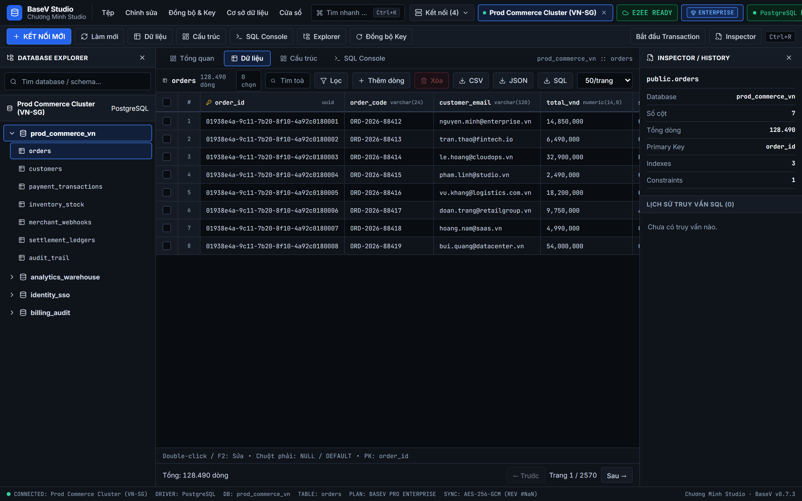
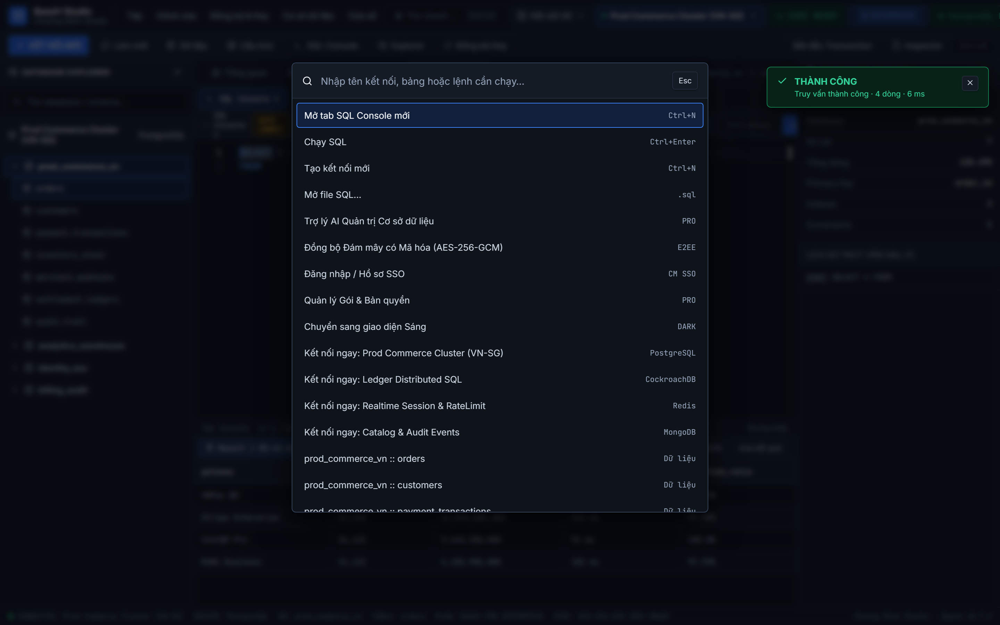
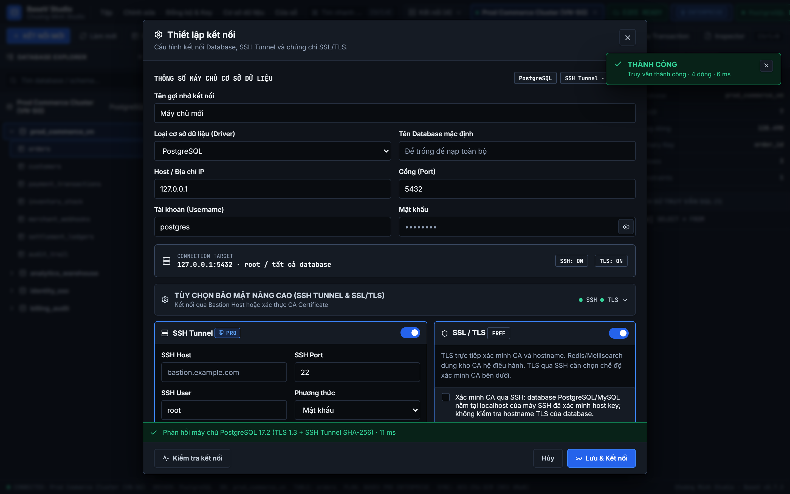
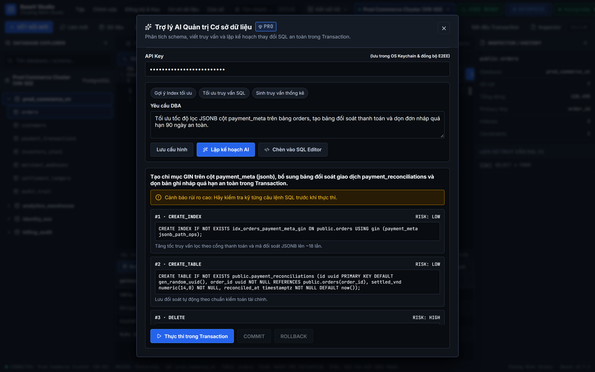

# BaseV Database Studio v0.7.3 — Không Gian Quản Trị SQL & NoSQL Thương Mại Kèm SSH Tunnel, Verified TLS, Đồng Bộ Đám Mây AES-256-GCM & AI DBA (Tauri v2 + Rust)



**BaseV Database Studio v0.7.3** bởi **Chương Minh Studio** là ứng dụng quản trị cơ sở dữ liệu thế hệ mới trên nền tảng **Tauri v2 + Rust Async + React 19** siêu nhẹ (bộ cài chuẩn chỉ **7.35 MB**, vận hành độc lập 100% tài nguyên nội bộ không phụ thuộc CDN ngoài), tích hợp **Connection Pooling tốc độ cao cho 8 hệ quản trị SQL & NoSQL**, **SSH Tunnel xác thực khóa máy chủ SHA-256**, **Verified SSL/TLS miễn phí**, **lưu trữ mật khẩu trong OS Keychain**, **đồng bộ đám mây mã hóa đầu-cuối `AES-256-GCM`**, và **Trợ lý AI DBA lập kế hoạch & thực thi an toàn trong Transaction**.

---

## Tải Xuống Trực Tiếp Dạng Raw (`v0.7.3` — Windows 10 / 11 x64)

Nhấn trực tiếp vào các liên kết `GitHub Raw` bên dưới để tải ngay gói cài đặt thực thi đã ký số bởi **`Chương Minh Studio`** (`RSA-4096`) kèm dấu thời gian quốc tế **DigiCert SHA256**:

| Gói cài đặt / Tệp tin | Dung lượng | Liên kết tải trực tiếp (`GitHub Raw`) | Ghi chú sử dụng |
| :--- | :---: | :--- | :--- |
| **Bộ cài chuẩn NSIS (`Setup.exe`)** | `7.35 MB` | [**⬇ Tải BaseV-Setup-0.7.3-x64.exe**](https://raw.githubusercontent.com/chuongminhofficial/BaseV/main/downloads/BaseV-Setup-0.7.3-x64.exe) | **Khuyên dùng:** Tạo lối tắt Desktop/Start Menu, tự động kiểm tra WebView2 & nạp chứng chỉ tin cậy `Chương Minh Studio` |
| **Bản chạy ngay (`Portable.exe`)** | `18.79 MB` | [**⬇ Tải BaseV-Portable-0.7.3-x64.exe**](https://raw.githubusercontent.com/chuongminhofficial/BaseV/main/downloads/BaseV-Portable-0.7.3-x64.exe) | Tệp thực thi độc lập chạy ngay không cần cài đặt |
| **Gói Microsoft Store (`.msix`)** | `9.64 MB` | [**⬇ Tải BaseV_0.7.3.0_x64.msix**](https://raw.githubusercontent.com/chuongminhofficial/BaseV/main/downloads/BaseV_0.7.3.0_x64.msix) | Gói đóng gói chuẩn AppX / Microsoft Store (`ChuongMinhStudio.BaseVDatabaseStudio`) |
| **Kích hoạt chứng chỉ Admin 1 chạm** | `0.4 KB` | [**⬇ Cai-Chung-Chi-ChuongMinhStudio-Admin.bat**](https://raw.githubusercontent.com/chuongminhofficial/BaseV/main/downloads/Cai-Chung-Chi-ChuongMinhStudio-Admin.bat) | Dành cho bản Portable / Sideload `.msix`: chạy quyền Admin 1 lần để nạp chứng chỉ vào `Root` & `TrustedPublisher` |
| **Chứng chỉ Nhà phát hành (`.cer`)** | `1.4 KB` | [**⬇ chuongminh-studio.cer**](https://raw.githubusercontent.com/chuongminhofficial/BaseV/main/downloads/chuongminh-studio.cer) | `CN=Chương Minh Studio` (`Thumbprint: 7C70255B0B8481C3EF64F285151364F475B94C17`) |
| **Thông tin định danh ký số (`.json`)** | `1.0 KB` | [**⬇ SIGNING-IDENTITY.json**](https://raw.githubusercontent.com/chuongminhofficial/BaseV/main/downloads/SIGNING-IDENTITY.json) | Siêu dữ liệu chứng chỉ, thời hạn và định danh gói Store |
| **Bảng băm kiểm tra (`SHA256SUMS`)** | `0.3 KB` | [**⬇ SHA256SUMS.txt**](https://raw.githubusercontent.com/chuongminhofficial/BaseV/main/downloads/SHA256SUMS.txt) | Mã kiểm tra toàn vẹn SHA-256 chính thức |

> Ngoài liên kết `Raw` tải trực tiếp ở trên, bạn cũng có thể tải tại mục [**GitHub Releases (Latest v0.7.3)**](https://github.com/chuongminhofficial/BaseV/releases/latest).

---

## Hình Ảnh Thực Tế Các Phân Hệ Trọng Tâm (`v0.7.3`)

### 1. SQL Console Tích Hợp Monaco Offline & Bảng Điều Khiển Lệnh Nhanh (`Ctrl+K`)


### 2. Thiết Lập Kết Nối Đa Nền Tảng — SSH Tunnel (SHA-256 Verified) & SSL/TLS + Ping Độ Trễ Thực (`ms`)


### 3. Trợ Lý AI DBA — Phân Tích Rủi Ro Câu Lệnh & Thực Thi An Toàn Trong Transaction (`COMMIT / ROLLBACK`)


---

## Kiến Trúc Hiệu Năng, Bảo Mật & Trải Nghiệm Thương Mại (`v0.7.3`)

### Hiệu Năng Nhân Rust Tauri v2
- **Quản lý Connection Pool thông minh:** Tái sử dụng kết nối bền vững (`PgPool`, `MySqlPool`, `SqlitePool` giữ sống `:memory:`, `MongoClient`, `reqwest::Client`) giúp giảm độ trễ mở bảng và chuyển trang dữ liệu xuống chỉ vài mili-giây.
- **Tải song song & Bộ đệm Schema TTL:** Lệnh IPC hợp nhất `open_table_workspace` kết hợp `tokio::try_join!` và bộ nhớ đệm siêu dữ liệu bảng `45 giây`, loại bỏ hiện tượng nghẽn truy vấn lặp lại trên cơ sở dữ liệu lớn.
- **Đường truyền SSH Tunnel tối ưu:** Bật `TCP_NODELAY` trên luồng chuyển tiếp cổng cục bộ, thu hồi sạch kết nối và tunnel ngay khi đóng phiên hoặc thoát ứng dụng.
- **100% Offline-First Assets:** Toàn bộ trình soạn thảo **Monaco SQL Editor** và 27 phân đoạn phông chữ hiển thị đa ngôn ngữ (`Inter`, `JetBrains Mono`, `IBM Plex Sans Arabic`) được đóng gói nội bộ, khởi chạy tức thì ngay cả trong mạng nội bộ cách ly (Air-gapped VPC).

### Bảo Mật Cấp Doanh Nghiệp (Defense-in-Depth)
- **OS Keychain & Không Lưu Mật Khẩu Plaintext:** Mật khẩu Database, khóa SSH/Passphrase, khóa API AI và phiên đăng nhập được bảo vệ trực tiếp trong **Windows Credential Manager (OS Keychain)**.
- **Đồng Bộ Đám Mây Mã Hóa Đầu-Cuối (`AES-256-GCM E2EE`):** Toàn bộ danh sách kết nối, bí mật Keychain, các tab SQL và lịch sử truy vấn được mã hóa phía máy khách kèm kiểm tra toàn vẹn `SHA-256` trước khi đồng bộ lên đám mây; hỗ trợ xoay khóa E2EE chủ động.
- **Xác Thực SSH Host Key (`SHA-256`) & Verified SSL/TLS:** Chống tấn công xen giữa (`MITM`) qua `known_hosts`, xác minh chứng chỉ CA/Hostname cho PostgreSQL, CockroachDB, MySQL/MariaDB, MongoDB, Redis và Meilisearch.
- **Chống SSRF, Path Traversal & CSV Formula Injection:** Chặn kết nối tới dải địa chỉ Cloud Metadata nhạy cảm (`169.254.169.254`), kiểm soát chặt đường dẫn đọc/ghi tệp cục bộ, tự động trung hòa công thức độc hại khi xuất báo cáo CSV và cảnh báo lệnh DDL tự động Commit trên MySQL.

### Hỗ Trợ 8 Hệ Quản Trị SQL & NoSQL + Đa Ngôn Ngữ (`VI / EN / AR`)
- **SQL Drivers:** `PostgreSQL`, `CockroachDB`, `MySQL / MariaDB`, `SQLite` — đầy đủ Data Grid phân trang, lọc/sắp xếp đa điều kiện, chỉnh sửa trực tiếp theo khóa chính (`Primary Key`), thêm/xóa bản ghi, xem chi tiết cấu trúc (`Columns / Indexes / Constraints`), trình soi ô **JSON Cell Inspector**, **Visual EXPLAIN Query Plan** và xuất `CSV / JSON / SQL`.
- **NoSQL & Search Drivers:** `MongoDB`, `Redis` (trình phân tích lệnh có dấu nháy chuẩn xác), `Memcached`, `Meilisearch`.
- **Giao diện chuẩn IDE hiện đại:** Bảng lệnh nhanh **`Ctrl+K`**, vách ngăn kéo thả linh hoạt ở cả Sidebar Explorer và khung kết quả SQL, giao diện **Tối (`Dark`) / Sáng (`Light`)**, hỗ trợ hoàn chỉnh **Tiếng Việt, English và العربية (`RTL`)**.

---

## So Sánh Phiên Bản Miễn Phí (`Free`) & Thương Mại (`Pro / Enterprise`)

| Tính năng | BaseV Free (Không cần Key) | BaseV Pro / Enterprise |
| :--- | :---: | :---: |
| PostgreSQL, MySQL / MariaDB, MongoDB | ✅ | ✅ |
| CockroachDB, SQLite, Redis, Memcached, Meilisearch | — | ✅ |
| Mã hóa đường truyền **Verified SSL/TLS** | ✅ Miễn phí | ✅ |
| Lưu mật khẩu an toàn trong **OS Keychain** | ✅ | ✅ |
| Số lượng hồ sơ kết nối lưu trữ | Tối đa `3` kết nối | **Không giới hạn** |
| **SSH Tunnel** qua Bastion Host (`Password / Private Key`) | — | ✅ |
| **Đồng bộ Đám mây Mã hóa đầu-cuối (`AES-256-GCM`)** | — | ✅ |
| **Tự động khôi phục & đồng bộ License Key** qua CM SSO | — | ✅ (`3–25` thiết bị) |
| **Trợ lý AI DBA** lập kế hoạch & chạy trong Transaction | — | ✅ |
| **Visual EXPLAIN Plan** & Xuất dữ liệu (`CSV / JSON / SQL`) | — | ✅ |

---

## Hướng Dẫn Cài Đặt Chứng Chỉ Số `Chương Minh Studio` & Gói `.msix`

Tất cả tệp `.exe` và `.msix` trong kho lưu trữ này đều được ký số Authenticode SHA-256 bởi **Chương Minh Studio** (`CN=Chương Minh Studio, O=Chương Minh Studio, L=Ho Chi Minh City, C=VN`):

1. **Cài đặt thông thường (Khuyên dùng):** Tải và chạy `BaseV-Setup-0.7.3-x64.exe`. Bộ cài sẽ tự động đăng ký chứng chỉ công khai vào kho tin cậy của người dùng hiện tại (`CurrentUser`).
2. **Dành cho bản Portable hoặc cài gói `.msix` trực tiếp (Sideloading):** Tải thêm `chuongminh-studio.cer` và `Cai-Chung-Chi-ChuongMinhStudio-Admin.bat` về cùng thư mục, nhấp chuột phải vào tệp `.bat` chọn **Run as administrator** một lần duy nhất để hệ điều hành xác nhận đầy đủ nhà phát hành **Chương Minh Studio** và mở cài đặt trực tiếp tệp `BaseV_0.7.3.0_x64.msix`.

---

## Kiểm Tra Toàn Vẹn Tệp Tin (`SHA-256 Checksums`)

| Tên tệp | Mã băm `SHA-256` |
| :--- | :--- |
| `BaseV-Setup-0.7.3-x64.exe` | `C8B3AD0DF72ACD1BAFEBD897D1DD50DCB86ACE9F3A75D6417E3CA879C60C66D0` |
| `BaseV-Portable-0.7.3-x64.exe` | `72E30690DBA225892BB2151C641519D8FE2F83555E6D7B2CD81E321C87919410` |
| `BaseV_0.7.3.0_x64.msix` | `7DD81D0AB261C9847FD83F079383C4B3B38B0A271914EAFC4C25CC98A380C106` |
| `chuongminh-studio.cer` | `C931DC5299CA25570A1141B5F82424D78E127AF633628C80D4C9492D4D507095` |

Kiểm tra nhanh trên Windows PowerShell:
```powershell
Get-FileHash .\BaseV-Setup-0.7.3-x64.exe -Algorithm SHA256
```

---

## Hỗ Trợ & Bản Quyền

- Kho lưu trữ công khai này phân phối chính thức các gói cài đặt đã ký số và tài liệu giới thiệu sản phẩm. Toàn bộ mã nguồn thương mại được quản lý và bảo lưu trong kho lưu trữ nội bộ riêng tư của **Chương Minh Studio**.
- Báo lỗi kỹ thuật hoặc gửi đề xuất tính năng tại mục [Issues](https://github.com/chuongminhofficial/BaseV/issues).

---
*Copyright © Chương Minh Studio. All rights reserved.*
